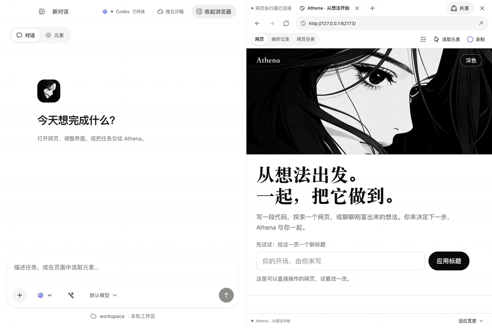
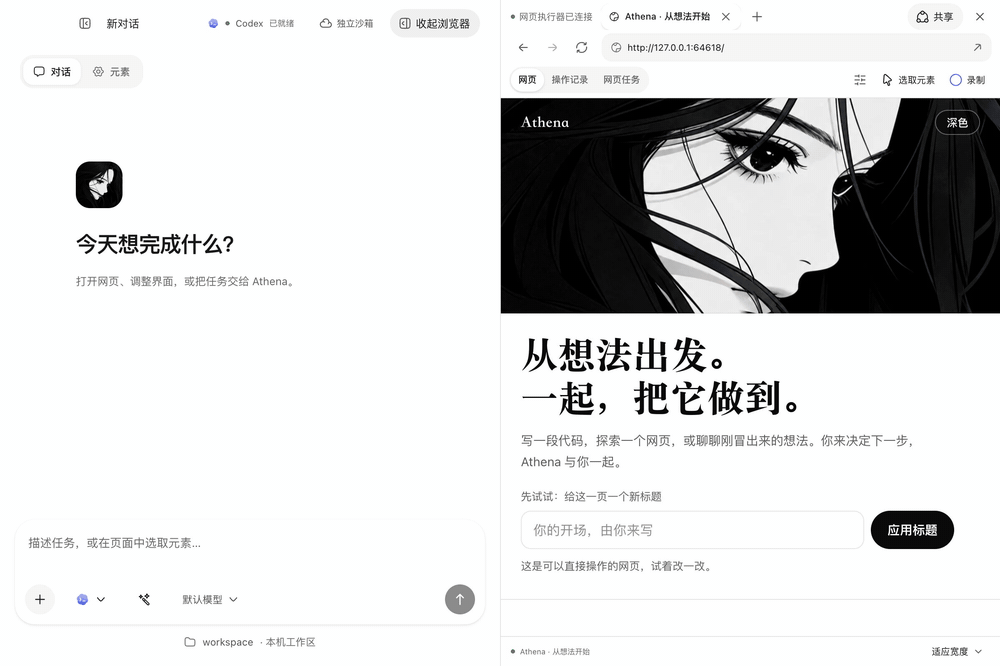
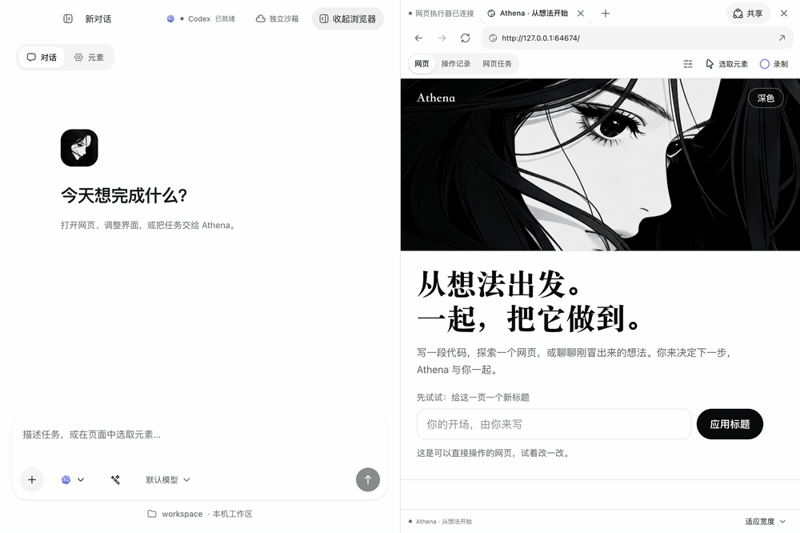
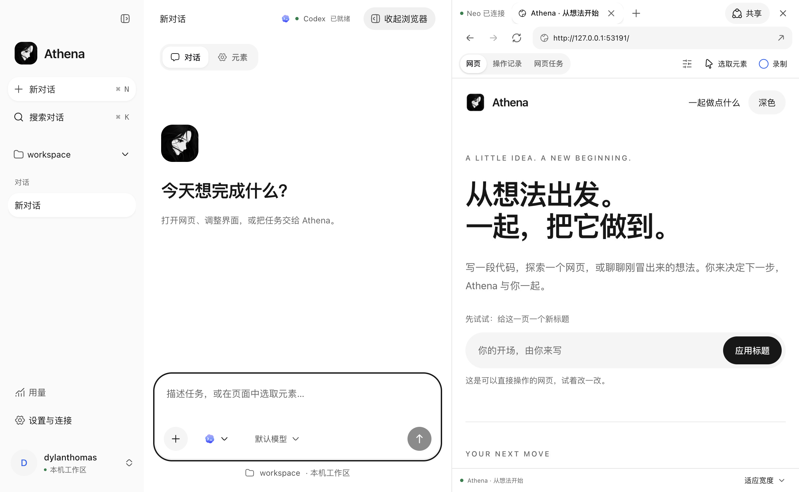

<p align="center">
  
</p>

<h1 align="center">ATHENA</h1>

<p align="center">
  <strong>网页，是人和 AI 的共同语言。</strong>
</p>

<p align="center">
  一款 macOS 桌面工作台：左边对话，右边是一张真实网页。<br />
  你指它改，它改你看，它指你做。改动当场可见，随时可以撤销。
</p>

<p align="center">
  <a href="#快速开始"><strong>快速开始</strong></a>
  &nbsp;·&nbsp;
  <a href="docs/user-guide.md">使用指南</a>
  &nbsp;·&nbsp;
  <a href="docs/page-collaboration.md">页面协作</a>
  &nbsp;·&nbsp;
  <a href="CHANGELOG.md">更新日志</a>
</p>

<p align="center">
  <sub>macOS · Apple Silicon · v0.11.1</sub>
</p>

<p align="center">
  
</p>

<p align="center"><sub>一句话把整页改成报纸头版，多枚光标自上而下画出新样子，再一句话撤销。</sub></p>

## 为什么是网页

让 AI 处理一张网页时，交流几乎都发生在页面之外：先用文字描述“右上角那个蓝色按钮”，等任务结束后读一段总结，不合适就换个说法再来一遍。Athena 把这张页面本身变成交流的媒介，只专注一件事：**人和 AI 怎样在浏览器页面上一起工作。**

| 环节              | 常见做法                            | 在 Athena 里                                 |
| ----------------- | ----------------------------------- | -------------------------------------------- |
| 📍 告诉 AI 改哪里 | 用文字描述位置，或截图后标注        | 在网页上点选元素，元素本身随消息发给 AI      |
| 👀 看 AI 做了什么 | 等任务结束，读一段文字总结          | 光标在页面上逐处完成改动，过程就在眼前       |
| ↩️ 结果不满意     | 重新描述一遍，或自己动手改回去      | 说一句“撤销”，页面恢复原样                   |
| 🙋 需要本人操作   | AI 给出文字步骤，人对照着在页面上找 | AI 在页面上圈出每一步，点击和输入由本人完成  |
| 🚀 让改动落地     | 把页面意见整理成需求，转交开发排期  | 记录页面上的改动，找到对应仓库，在沙箱里构建 |

## 同一张页面，三种配合

区别只在于谁来指、谁来动手。三种方式用的是同一张页面、同一套光标语言，可以在一次对话里随时切换。

<table>
  <tr>
    <td width="50%" valign="top">
      <h3>👆 你指，Athena 改</h3>
      <p>点击「选取元素」，在页面上点一下要改的地方，它就以一个标记进入输入框。只需要说“改成什么样”，不必再描述“改哪里”。</p>
      
    </td>
    <td width="50%" valign="top">
      <h3>🙋 Athena 指，你来做</h3>
      <p>对 Athena 说“带我做”。它在页面上圈出每一步，点击和输入都由你完成。Athena 只知道每一步是否完成，读不到你填写的内容。</p>
      
    </td>
  </tr>
</table>

### 🎬 Athena 改，你看着

不选任何东西，直接说出想要的样子。Athena 用一次调用提交整页的样式和文字改动，随后几枚彩色光标从页面顶部开始，一块一块把新样子画出来；页面很长时，画面跟着光标一路向下走完整页。你一动鼠标，演示立即让位。本页顶部的动图就是这个过程。

<sub>三段动图录自真实应用的隔离档案，页面上的选取框、光标和改动都是产品实际运行的画面。为便于观看，Agent 的指令由演示脚本给出，省去了模型思考的等待。</sub>

### 三条共同的规则

| 👁️ 过程可见                                          | ✋ 随时接管                                                               | ↩️ 都能撤回                                              |
| ---------------------------------------------------- | ------------------------------------------------------------------------- | -------------------------------------------------------- |
| 每一次修改都有光标演示和操作记录，谁做了什么分得清。 | 你可以随时操作页面或停止任务；人动过页面后，Athena 会重新读取页面再继续。 | 页面上的改动先是预览，可以逐次撤销；确认之后才进入源码。 |

## 能力一览

|     | 能力                   | 说明                                                                                                                                                                       |
| --- | ---------------------- | -------------------------------------------------------------------------------------------------------------------------------------------------------------------------- |
| ⚡  | **整页改版，一次调用** | 每轮对话附带当前页面的结构概览，Agent 用一次 `workbench_browser_restyle` 提交整份样式和文案改动，无需确认即刻生效，一次撤销全部收回。                                      |
| 🖱️  | **光标演示**           | 页面先改好，再由多枚光标把变化的部分逐块揭开。光标数量按工作量分配；「减弱动态效果」下不播放。                                                                             |
| 🧭  | **带做**               | Agent 在页面上逐步高亮该点哪里、该填什么，操作由你完成，适合登录、付款、最后确认这类只应由本人完成的步骤。[了解带做 →](docs/guide.md)                                      |
| 🚀  | **页面改动落到源码**   | 页面上确认过的预览被逐条记录，经知识库找到对应仓库，在前端、后端两个沙箱里修改、构建并启动预览；凭据不进入沙箱。[了解流程 →](docs/page-changes-to-source.md)               |
| 🌱  | **记忆**               | 从你自己的原话和应用记录的操作中学习规范与知识，每条都能看到依据，可停用、删除或导出为 Markdown。[了解记忆 →](docs/learning.md)                                            |
| 📦  | **沙箱**               | 在「设置」里创建一个或多个命名的沙箱，运行在 Coder 工作区或本机 Docker 里，对话里点名即可使用；闲置自动停止，长期不用自动删除，可标记保留。[了解沙箱 →](docs/sandboxes.md) |
| 📨  | **消息队列**           | 任务进行中可以继续发送消息，前面的任务完成后按顺序逐条发送；排队的消息可取回编辑或移出。                                                                                   |
| ⏺️  | **录制与共享**         | 把一段网页操作录下来交给 Agent 理解；邀请他人进入同一张页面，分别管理查看、操作和控制权。[了解共享 →](docs/shared-workspace.md)                                            |
| 🧩  | **Skills、MCP 与命令** | 「设置」里查看本机 Skills，连接各 CLI 已配置的 MCP 服务而不改写其配置；输入 `/` 打开命令菜单（`/new`、`/model`、`/agent`、`/browser` 等）。                                |
| 🤖  | **复用本机 CLI**       | 使用你已安装并登录的 Codex、Claude Code、Pi、OpenCode 等 CLI，不另设账户。各 CLI 的能力与验证范围见 [验收矩阵](docs/mainstream-cli-support.md)。                           |
| 💬  | **飞书**               | 在飞书私聊或群聊里 @ 机器人发起任务，结果回复到原处。[了解连接 →](docs/feishu-setup.md)                                                                                    |

> **实测：同一个任务，换一种交互方式。** 把起始页整页改成另一种风格，逐个元素修改时用了近 50 次工具调用、10 次确认、约 150 秒；改为一次提交整页改版后，只需 1 次调用、无需确认、约 30 秒。这是本机一次真实对话的对比，耗时主要取决于所选模型生成样式的速度。

## 界面

<p align="center">
  
</p>

<p align="center"><sub>项目、对话与网页，在同一个窗口里。</sub></p>

## 快速开始

### 安装包

下载 **[Athena 0.11.1](https://github.com/bitcat-ai/athena/releases/tag/v0.11.1)**（[DMG](https://github.com/bitcat-ai/athena/releases/download/v0.11.1/Athena-0.11.1-mac-arm64.dmg) · [ZIP](https://github.com/bitcat-ai/athena/releases/download/v0.11.1/Athena-0.11.1-mac-arm64.zip) · [SHA-256 校验](https://github.com/bitcat-ai/athena/releases/download/v0.11.1/SHA256SUMS.txt) · [全部版本](https://github.com/bitcat-ai/athena/releases)），打开 DMG 后把 Athena 拖入「应用程序」。安装包包含本页介绍的全部能力，已完成 Developer ID 签名和 Apple 公证，尚无自动更新。

需要 macOS（Apple Silicon）、Google Chrome，以及一个已登录的本机 Agent CLI（如 Codex）。启动后，右侧浏览器默认打开 Athena 的起始页。页面上为三种协作方式各准备了一句示例，照着说一遍就能体验。

### 从源码运行

需要 Node.js **22.12+**，其余要求与安装包相同。

```bash
npm ci
npm run setup:agent-browser
npm run dev
```

构建授权的准备见下方「从源码开发」。

<details>
<summary>看看与 Athena 的第一次对话</summary>

首次打开时，引导会检测本机 Agent 并让你选择已有连接，按需展示安装计划；项目文件夹可跳过，网页工具可稍后准备。选择和实际结果保留在连续对话中，可以回看，也可以稍后从设置重新打开。


</details>

## 使用之前

- **按 CLI 的实际能力执行任务。** 模型请求使用对应账户的配额或计费。网页工具支持 Codex、Claude、Pi 和 OpenCode；Pi 的远端模型 UI 续聊仍待排查，Cursor 与 Gemini 的真实模型验收未完成，详见 [CLI 验收矩阵](docs/mainstream-cli-support.md)。
- **网页功能需要本机的 Google Chrome。** Athena 使用独立的浏览器数据，不读取日常浏览器配置，也不替你下载或安装浏览器。网页执行器是固定版本的 agent-browser，首次使用时从官方发布下载并校验。
- **费用展示为 API 等价估算。** 它不代表订阅实际扣费；未知或不完整的用量会保留其状态。
- **数据留在本机。** 设置、对话、录制和记忆保存在本机的应用数据目录，飞书凭据经系统密钥存储加密。详见 [数据与凭据](docs/user-guide.md#数据与凭据)。

Athena 专注浏览器页面上的协作，桌面 Computer Use 仍处调研阶段。当前能力与验证范围见 [用户指南](docs/user-guide.md#能力与验证边界)。

## 文档

| 开始使用                                                          | 进一步了解                                                                |
| ----------------------------------------------------------------- | ------------------------------------------------------------------------- |
| [用户指南](docs/user-guide.md) · 安装、引导与日常使用             | [浏览器交互协议](docs/browser-interaction-protocol.md) · 工具职责与控制权 |
| [在同一张页面上协作](docs/page-collaboration.md) · 三种协作方式   | [网页执行器](docs/web-executor.md) · Chrome 与 agent-browser              |
| [带做](docs/guide.md) · Agent 指，你来做                          | [本机 CLI 适配](docs/mainstream-cli-support.md) · 能力与验收矩阵          |
| [页面改动落到源码](docs/page-changes-to-source.md) · 知识库与沙箱 | [模型与用量](docs/agent-experience.md) · 执行证据与统计口径               |
| [记忆](docs/learning.md) · 从使用中学习                           | [设计约定](DESIGN.md) · 视觉语言与组件映射                                |
| [页面共享](docs/shared-workspace.md) · 邀请、权限与控制权         | [工程约定](AGENTS.md) · 开发与验证规则                                    |
| [飞书连接](docs/feishu-setup.md) · 配对与连接恢复                 | [更新日志](CHANGELOG.md) · 版本变化与下载                                 |
| [沙箱](docs/sandboxes.md) · 多个实例与回收规则                    | [签名与公证](docs/apple-signing.md) · 构建与发布                          |
|                                                                   | [贡献指南](CONTRIBUTING.md) · 问题反馈、开发与 Pull Request               |

<details>
<summary><strong>从源码开发</strong></summary>

需要 Node.js **22.12+**、npm 和 HeroUI Pro 构建授权。运行 `npm ci` 前，将 CollectUI 分发的 HugeIcons Pro npm key 配置到本机用户级 `~/.npmrc`，不要写入仓库；步骤见 [开发环境与验证](docs/user-guide.md#开发环境与验证)。项目的 `.npmrc` 仅将 `@hugeicons-pro` 指向 CollectUI 私服，`@hugeicons/react` 渲染器从公共 npm 安装。

```bash
npm ci
npm run setup:agent-browser
npm run dev
```

`npm ci` 会执行 `heroui:setup`，优先恢复本机授权缓存。新环境需私下配置 `HEROUI_KEY`；不要提交密钥或完整 Pro 包。`setup:agent-browser` 把固定版本的官方 agent-browser 下载到 `.runtime/` 并校验 SHA-256，不启动任何进程；网页功能另需本机已安装 Google Chrome。

```bash
npm run typecheck
npm test
npm run build
npm run package
```

Developer ID 正式签名使用 `npm run package:signed`；公证分发使用 `npm run package:release`，需要本机钥匙串公证凭据。步骤与验证见 [macOS 签名与公证](docs/apple-signing.md)。普通 `npm run package` 保持本机 ad-hoc 签名。

多 CLI 适配进度、能力限制与验收情况见 [本机 CLI 适配](docs/mainstream-cli-support.md)；已发布安装包以其发布说明为准。运行任务需所选 CLI 已完成本机登录。完整环境说明和测试范围见 [开发环境与验证](docs/user-guide.md#开发环境与验证)。

</details>

## 许可

本仓库公开可见，项目代码保持 **UNLICENSED**，尚未授予开源许可证。HeroUI Pro 是商业授权组件，其完整包、源码和密钥不随本仓库分发。第三方许可见 [THIRD_PARTY_NOTICES](THIRD_PARTY_NOTICES.md)。
