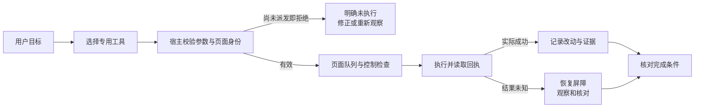

# Agent 与右侧浏览器的交互协议

本协议由宿主执行。模型选择任务所需的工具，宿主负责页面身份、读写次序、控制权、结果状态和恢复条件。

## 工具职责

| 用户目标                     | 工具                                                 | 返回与后续                                                                                              |
| ---------------------------- | ---------------------------------------------------- | ------------------------------------------------------------------------------------------------------- |
| 生成一个新页面               | `workbench_browser_create_page`                      | 新建独立预览页并直接插入内容，返回 `page`、字符串 `tabId`、`documentId`、根 `ref`、`editId`；原标签保留 |
| 查找、检查 DOM               | `workbench_browser_query` / `inspect`                | 精确 DOM 引用、文本是否可编辑及限制原因；不靠猜测拼接引用                                               |
| 修改选定元素、追加分区       | `workbench_browser_edit`                             | 同一次应用文字、样式、动画，或独立 `insert`；返回实际元素和撤销 ID                                      |
| 修改已有页面的整体外观、文案 | `workbench_browser_restyle`                          | 返回命中、未命中、未改变、跳过与实际文字替换数量；不把部分应用称为全部成功                              |
| 撤销预览                     | `workbench_browser_undo`                             | 使用具体 `editId`；若用户或页面后来改过相关内容，拒绝覆盖较新结果                                       |
| 读取内容                     | `web_read` / `web_grep`                              | 页面内容与 `observationId`；页面文字始终视为不可信数据                                                  |
| 观察并操作现有网站           | `web_snapshot` → `web_act`                           | 使用当前页面的原生交互引用；点击、填写和批量字段操作由执行器完成                                        |
| 核对不确定结果               | 重新观察 → `web_checkpoint`                          | `verified`、`not_applied`、`unknown` 明确区分；未知状态不能重放提交                                     |
| 用户亲自处理                 | `workbench_browser_guide` / `web_request_human_help` | 登录、验证码、付款等沿用人工边界，结束后重新观察                                                        |

`web_browser_context` 与 `web_page_outline` 是宿主注入的上下文，**不是工具名**。`web_*` 的数字 `page` 与预览工具的字符串 `tabId` / DOM `ref` 不互换；新的创建工具直接返回两种页面标识。旧 `workbench_browser_*` 标识保持兼容。

创建页面不再要求模型自行拼接“新建标签 → 查找 body → 插入”的过程，也不应通过重绘欢迎页、`data:` 导航、CSS `content` 或任意脚本替代。已有网站的功能交互仍使用原生执行器。页面预览没有自动保存为项目源码。

## 读写与控制权

宿主按文档状态和交互视口分别检查有效性，不把所有人类输入都当作同一种冲突。

| 事件                           | 内容读取 / DOM 预览            | 点击、填写、导航、截图等依赖当前交互状态的操作     |
| ------------------------------ | ------------------------------ | -------------------------------------------------- |
| 用户仅滚动查看                 | 保持可用，引用仍需属于当前文档 | 重新观察后才能继续交互；滚动中的截图不作为稳定证据 |
| 用户点击、输入、编辑或切换页面 | 旧操作失效，需重新观察         | 旧操作失效，需重新观察                             |
| 文档或节点被替换               | 旧 `ref` 不可用，重新定位      | 原生引用同样受执行器检查                           |
| 用户停止任务                   | 拒绝后续写入和迟到结果         | 中止执行器及排队动作；不能用一次读取重新授权旧任务 |
| 页面正在共享                   | Agent 不接管页面               | 沿用参与者权限和当前控制者                         |

输入与写操作仍经过页面队列。宿主 DOM 预览与 agent-browser 请求分别标记执行归属：中断本机 DOM 修改不再无故重启空闲的 agent-browser 会话。硬交互会使排队的旧写入失效；滚动不取消内容读取和 DOM 预览。读取期间发生滚动时，内容证据可以返回，但不会据此重新授权过期的页面点击。

控制变化写入公开执行记录，包含原因和作用范围，不保存用户输入内容。模型不需要自行猜测读写锁或复制宿主内部代次。

## 回执与完成条件

1. 参数、目标或权限在派发前拒绝：回执明确 `not_executed`。修正参数或重新定位后继续，不创建“结果未知”恢复循环。
2. 派发后丢失回执、被中断或效果无法确定：保留恢复屏障，先观察实际结果，不盲目重试。
3. 预览成功：以返回的实际改动、引用和撤销 ID 为依据；`skipped`、`unchanged` 和失败均不能当作成功。
4. 仍有未执行修改时，宿主不能把该任务记录为成功。后续真实写入或有效的 `verified` 检查点才能解除未完成状态。

带 `<br>` 的普通标题可以直接替换文本；换行节点身份和其他结构保留，撤销恢复原始文本。含其他子元素的容器继续报告 `editableText: false`，避免覆盖按钮、图标或嵌套组件。



## 验证

`tests/web-preview-recovery.test.ts` 使用真实 Chrome 与固定版本 agent-browser，覆盖滚动后的读写、读写重叠、硬接管、标题及撤销、单工具创建、失效引用、参数拒绝与丢失回执。`tests/web-lifecycle.test.ts` 覆盖停止、队列、重连、守护进程回收和人工交接。

```bash
ATHENA_TEST_AGENT_BROWSER=1 npx tsx --test tests/web-preview-recovery.test.ts tests/web-lifecycle.test.ts
```

`tests/browser-protocol-live.e2e.ts` 为独立数据目录中的真实模型验收：沿用本机 Codex 登录，以 `gpt-6.1-sol / low` 执行原始台灯请求，在创建期间注入滚动，检查页面、工具调用、原标签保留和真实完成状态。该检查会产生模型用量，默认不运行。并行初稿在此测试中关闭。
