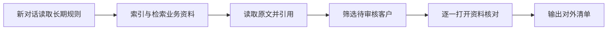
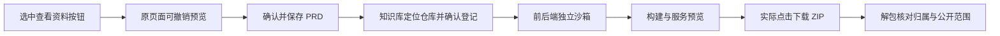

# Athena · 三个可演示、可复现的场景

> **定位：基于浏览器的 AI 交互应用程序。** 三个场景按“AI 指给人做 → AI 按业务知识做 → 人与 AI 把需求做成代码”展开。共用 Meridian 客户工作台，客户与资料全部虚构；每个场景也可单独启动。
>
> 设计依据：Athena `6b5441d400d115204866a6fdc170f1c3a07287ee` 及当前工作树；演示项目基线 `045db660db5203826be6563a46a0dee5292d75a2`。当前源码的能力不能用旧 v0.9.0 安装包代替。本轮完成方案、复现入口和相关检查，尚未跑三条真实模型演练。

| 场景                               | 观众看到的变化                                           | 核心功能                                        | 建议展示时长*                              |
| ---------------------------------- | -------------------------------------------------------- | ----------------------------------------------- | ------------------------------------------ |
| ① 新同事第一次查客户资料           | AI 在页面指路，人亲手搜索、打开和核对                    | **带做、页面高亮、人机控制分工**                | 2–3 分钟                                   |
| ② 按规则核对待审核客户             | 从知识库找依据，操作真实列表，输出对外清单               | **知识检索、网页操作、跨对话记忆**              | 3–4 分钟                                   |
| ③ 把“想要一个导出按钮”变成真实功能 | 先在原页面预览，再生成 PRD，双沙箱构建，最后真的下载 ZIP | **元素预览/撤销、仓库定位、独立沙箱、交付核验** | 现场讲解 5–7 分钟；完整执行预留 15–30 分钟 |

\*这是脚本安排，不是性能测量。模型响应、首次依赖安装和机器状态会改变耗时。场景③若用已完成构建讲解，须明确告知“构建提前完成”，保留完整日志与原始时间；不要把等待剪掉后宣称几秒完成。

## 共同复现底座

### 哪些是真实执行，哪些是示例

| 层面                                     | 本方案默认方式                                                                             |
| ---------------------------------------- | ------------------------------------------------------------------------------------------ |
| Athena、Chrome、网页交互、引导卡与检查器 | 实际应用与浏览器                                                                           |
| 模型                                     | 本机已配置的 Codex；启动器不代发任务，粘贴提示词后才产生模型请求                           |
| 客户数据                                 | Meridian 固定的 15 个虚构客户，真实 React 页面与 Java API                                  |
| 知识内容                                 | 离线示例知识服务；Athena 实际执行 index/search/read 和出处处理，飞书网络读取由本地替身提供 |
| 源码与构建                               | 实际私有 Git 仓库、独立 Docker 环境、npm/Maven、真实服务和文件                             |
| 代码发布、飞书消息与录像                 | 不属于默认脚本；不自动推送、发消息或录制                                                   |

**默认模式不验证线上飞书授权、知识库权限或真实群消息链路。** 若要讲“真实飞书知识库”，先将示例资料原文放入指定测试知识库，在普通 Athena 档案配置真实入口并完成只读 index/search/read 预检，再按同样的场景走；不能把 `fixture.feishu.cn` 展示成线上客户系统。

### 准备一次，三个场景共用

1. 本机准备 Google Chrome、Docker Desktop、可用的 Codex 和仓库依赖。CLI 已安装不代表登录可用；演示前手动完成一次最小只读任务，核对实际模型响应。
2. 演示仓库必须是独立干净副本；不要 reset 当前有改动的目录。已有副本默认为 `.runtime/customer-export-demo/repo`，启动器只读它并要求精确基线。
3. 如没有副本，在**新的目录**取得仓库并检出上述基线；私有仓库访问权限须提前确认：

```bash
# REPO_DIR 必须指向新目录；若已存在，换一个新目录名。
mkdir -p .runtime/demo-sources
REPO_DIR="$PWD/.runtime/demo-sources/meridian-045db660"
git clone https://github.com/Dylan-Nihilo/athena-customer-materials-demo.git "$REPO_DIR"
git -C "$REPO_DIR" checkout --detach 045db660db5203826be6563a46a0dee5292d75a2
```

4. 在 Athena 仓库根目录构建当前源码、准备浏览器执行器并预检：

```bash
npm run setup:agent-browser
npm run build
# 默认已有演示副本；只做检查，不启动应用、模型或容器。
npx tsx scripts/demo-session.ts --check
# 自定义副本时：ATHENA_DEMO_SOURCE="$REPO_DIR" npx tsx scripts/demo-session.ts --check
```

源码构建沿用项目已有 HeroUI Pro/HugeIcons Pro 授权配置。预检要求 `athena-sandbox-node:1` 与 `athena-sandbox-java:1` 两个镜像已经准备；缺失时使用仓库现有 Dockerfile 准备（需要网络拉取基础镜像与软件包）：

```bash
docker build -t athena-sandbox-node:1 -f resources/sandbox/node.Dockerfile resources/sandbox
docker build -t athena-sandbox-java:1 -f resources/sandbox/java.Dockerfile resources/sandbox
```

启动器不会静默替你换基线。

5. 启动手动演示会话：

```bash
npx tsx scripts/demo-session.ts
# 使用刚才的新副本时：
# ATHENA_DEMO_SOURCE="$REPO_DIR" npx tsx scripts/demo-session.ts
```

启动器复用现有 `startCustomerRuntime`，实际构建并启动客户站点的前后端，随后打开**新的 Athena 专用档案**。终端给出本次 `url`、`profile`、`workspace` 和 `session.json` 路径；端口动态分配，后续都从该记录复制，不复用历史端口。

6. 在新窗口按实际检测完成首次准备，选择可用模型；展开浏览器并打开终端的 `url`。如果同时打开着日常 Athena，以本次独立窗口为准。知识入口已配置为示例根目录。
7. 开场核对：页面标有“演示工作区”；共 **15 位客户、每页 6 位**；第一页有 C1001；每行只有“查看资料”，**没有“导出材料”**。没有满足就先排查，不能继续场景③。

启动器写入的设置、知识替身和后续记忆仅属于 `.runtime/demo-scenarios/run-*`。它不复制日常聊天或飞书凭据。关闭本次 Athena 或在启动终端按 Ctrl+C 后，基线服务停止，档案与文件保留；不删除别的容器、历史演示目录或仓库。

### 单独复现与复位

| 范围                   | 复位方法                                                       | 保留什么                                       |
| ---------------------- | -------------------------------------------------------------- | ---------------------------------------------- |
| 页面搜索/抽屉/临时预览 | 重新打开本次基线 URL；关闭抽屉；清空搜索，状态选“全部合作状态” | 会话与记忆仍在专用档案                         |
| 场景中的 AI 上下文     | 新建对话，重新确认当前页面                                     | 同档案的已启用记忆仍生效                       |
| 全部场景从零再来       | 关闭本次窗口，重新运行启动器，取得新的 run 目录和 URL          | 上次运行记录保留，不覆盖                       |
| 场景③代码已改动        | 保留当前沙箱与日志；继续时先查状态，完整重演使用新的演示档案   | 不强制 reset、不重复克隆覆盖、不重做已成功动作 |

全局“删除所有记忆”、删除日常 profile、清理所有 Docker 容器都不是复位步骤。

---

## 场景① · AI 当教练，新人自己操作后台

**给观众的一句话：** “它不只会代办，也能在真实页面上教你做，每一次操作由你完成。”


### 初始状态

- 新对话，基线第一页，搜索为空，客户资料抽屉关闭。
- 浏览器未共享；页面内容在主文档内，不使用 iframe 带做。
- 这是最新的带做能力；当前自动化验证覆盖真实浏览器/模拟模型协议，真实模型选择工具的表现仍需演示前彩排。

### 演示台词与动作

| 步骤         | 你做什么 / 粘贴什么                                                       | 观众应看到什么                                     |
| ------------ | ------------------------------------------------------------------------- | -------------------------------------------------- |
| 1 · 开场     | “我是第一次用这个后台，请带着我做。”                                      | 说明 AI 与人面对同一真实页面                       |
| 2 · 搜索带做 | 粘贴下面第一段提示词，等待高亮；**你亲手**输入 `C1008` 并按带做卡“下一步” | 搜索框高亮、说明卡、对话内步骤进度；输入由用户完成 |
| 3 · 核对现场 | 让这段带做结束，Agent 重新读取列表                                        | 只剩“山岚文旅（虚构）”一行，编号 C1008             |
| 4 · 查看资料 | 粘贴第二段提示词；你点击高亮的“查看资料”                                  | 抽屉打开，AI 指出资料区，用户自行核对              |
| 5 · 结束     | 在带做卡结束，展示结果摘要                                                | AI 报告完成/结束的真实状态；页面上的带做浮层收起   |

第一段提示词：

```text
我是第一次使用这个客户工作台。请用“带做”在页面上指导我搜索客户 C1008，点击和输入由我自己完成。
先只带我完成搜索这一步，不要替我填写或打开资料。输入后我会点“下一步”。
这段带做结束后，请重新读取列表，确认是否确实出现 C1008，再告诉我结果。
```

第二段提示词：

```text
现在请继续带我查看 C1008 的客户资料：先高亮“查看资料”，由我点击；再指出公开材料区与“内部跟进”区，让我理解它们的区别。
不要替我点击、下载或修改页面。完成讲解后结束带做。
```

**为什么分两段：** 搜索会异步刷新列表，先核对 C1008 再绑定下一段目标，避免把旧列表的第一个同名按钮当作正确客户。

### 成功标准与证据

- 用户亲手输入和点击；`workbench_browser_guide` 出现在真实工具记录中。
- 第一段结束后有新的页面观察，结果是 **C1008 山岚文旅（虚构）**。
- 抽屉显示三份公开材料：**营业资质.md、服务协议.md、结算说明.md**；内部跟进单独显示。
- 保留一张高亮截图、一张抽屉截图，以及实际 guide 结束状态。不要把“下一步”按钮推进当作业务结果已核对。

### 可选亮点：把规则记下来

```text
请记住：以后整理客户对外资料时，不包含内部跟进备注。把这条规则作为我的长期要求保存，并告诉我它的编号。
```

只有工具确认保存成功且设置中的记忆条目带有本次原话依据，才算记住。这个编号留给场景②核对。独立演示场景②时，先在其专用档案执行此句即可。

### 意外情况

| 情况                       | 处理                                                                                       |
| -------------------------- | ------------------------------------------------------------------------------------------ |
| Agent 只回答文字，没有带做 | 补一句“请调用页面带做工具，当前先做一个搜索输入步骤”；仍失败则保留失败，不能用自画高亮代替 |
| 高亮目标不存在或列表没更新 | 结束当前带做，重新观察页面，再启动下一段                                                   |
| 演示者点“结束”或停止任务   | 明确展示结束状态；不让 Agent 自动补做剩余动作                                              |
| 想展示“交给 Athena”        | 作为单独彩排分支；交还后必须重新观察，不与本场“由人操作”主线混用                           |

**复位：** 结束带做 → 回基线 URL → 新对话。需要重演记忆从无到有时使用新 run，不删除日常记忆。

---

## 场景② · 有业务依据的客户材料核对

**给观众的一句话：** “同一个页面，AI 不只认按钮，还能按知识库规则做事，并沿用你之前确认的要求。”



### 初始状态

- 仍使用相同演示档案，**新建对话**；回到基线列表，清空搜索和状态筛选。
- 已保存上述长期规则；首次独立演示时先保存再开新对话。
- 知识服务含 5 份固定示例资料，其中有一份不适用于客户模块的供应商规则，用于展示选对资料。

先证明记忆跨对话：

```text
先不要调用工具。请告诉我：我之前要求你整理客户对外资料时遵守什么规则？带上这条记忆的编号。
```

随后执行业务任务：

```text
请根据已配置知识库中的“客户对外材料规则”，核对当前工作台所有“待审核”客户的公开材料。
先索引、检索并读取原文，确认适用于 customers 模块，引用真实返回的来源；不要套用供应商规则。
然后在网页上筛选“待审核”，逐个打开资料，核对客户编号、公司名、负责人和三份公开材料。
最后给我一份可对外使用的清单，并说明覆盖了几位客户。不要发送给任何人，也不要修改客户状态。
```

### 镜头与核对点

| 顺序 | 画面重点              | 应有证据                                       |
| ---- | --------------------- | ---------------------------------------------- |
| 1    | 新对话复述长期规则    | 与场景①相同的记忆编号，非再次临时提醒          |
| 2    | index → search → read | 返回示例资料的链接、版本/哈希，明确示例性质    |
| 3    | 浏览器选择“待审核”    | 页面显示 3 位客户                              |
| 4    | 依次查看三个抽屉      | 每个客户的编号、负责人、3 份公开材料与现场一致 |
| 5    | 简洁结果与来源        | 清单只含允许的对外信息，不包含内部跟进原文     |

### 固定基线的验收答案

| 客户编号 | 公司             | 负责人 | 公开材料数 |
| -------- | ---------------- | ------ | ---------- |
| C1004    | 微澜食品（虚构） | 林予   | 3          |
| C1009    | 木野制造（虚构） | 苏宁   | 3          |
| C1014    | 风屿商业（虚构） | 陈舟   | 3          |

合计 **3 位客户、9 份公开材料**。每位客户均为营业资质、服务协议、结算说明。基线没有设置材料缺失，不应为了剧情捏造缺件。报告不得出现 `INTERNAL_ONLY` 或内部跟进正文。

### 成功标准

- 新对话获得已保存规则，且没有把供应商规则混入客户任务。
- 业务判断引用知识工具实际返回的原文来源；页面客户和材料由新的浏览器观察核对。
- 清单与上表一致，覆盖范围明确；页面记录未修改，报告未对外发送。
- 保存任务记录、最终清单和筛选结果截图。工具调用成功本身不替代清单核对。

### 意外情况与复位

- 知识读取失败：展示具体失败并停在规则核对，不把记忆或标题当成完整原文。离线模式可重启专用会话排查；真实飞书模式按实际授权处理。
- 记忆未出现：核对规则是否保存、启用、是否在相同档案；不要伪装成已记住。
- 可选加演“消息队列”：任务进行中追加“完成后再按负责人分组”，观察进入队列；停止或失败后的队列不自动继续。它不是主线必需项。
- 复位：回基线 URL，清空筛选，新建对话。没有产生业务写入，不需要清数据库。

---

## 场景③ · 从页面上的需求到双沙箱真实功能

**给观众的一句话：** “你指出页面上想改变的地方，Athena 先给你看效果，再找到真实代码，把功能做出来并核验文件。”



### 初始状态

- 新对话，原基线 URL，第一页、搜索为空。**当前页面没有导出材料按钮**。
- 当前工作目录是启动器的空演示 workspace，不是 Meridian 源码目录；才能展示“按知识定位仓库”链路。
- 宿主已有真实私有仓库读取权限。运行前检查远端 main 与固定基线一致；若已变化，另行准备经确认的基线分支与映射，不盲用旧提交。
- 默认展示内置仓库登记流程，未设置外部 `ATHENA_REPOSITORY_MCP_*`。

### 四轮短对话

**第一轮：指向对象，先做预览。** 在网页选中 C1001 行的“查看资料”按钮，再发送：

```text
在这个按钮右侧增加“导出材料”按钮。先只做当前页面的位置和样式预览，保持原按钮文字不变。
我希望最终每个客户都能导出自己的材料，但现在不要改源码、不要下载文件。
```

画面上应出现新按钮和真实预览记录。可以先撤销，再要求恢复同一预览，展示可逆性；若已撤销，必须重新生成实际预览后才能进入下一轮。

**第二轮：把意图变成可核对的需求。**

```text
这个位置和样式可以。请把当前实际显示的预览保存成 PRD。
功能范围是每个客户行都可下载自己的 ZIP，包含 customer.json 与该客户三份公开材料；排除内部跟进、其他客户资料和危险路径。
还要有下载中防重复点击、失败提示和重试；筛选、分页后不能串客。先给我查看 PRD，不要开始写代码。
```

打开真实 PRD 卡片，检查原始要求、选中对象/页面改动、验收条件、文件字节和 SHA-256。文件被保存不代表功能已实现。

**第三轮：查依据、确认仓库、进入独立环境。**

```text
按这份 PRD 实现。先从知识库读取本网站 customers 模块的仓库对应表与开发约定，再通过 workbench_repository_resolve 请求确认登记，不要猜仓库地址。
核对返回的基线与本次演示基线一致；不一致先停止说明。
在 target=frontend 和 target=backend 的独立沙箱里分别实现、测试、构建并启动预览。不要修改宿主项目，不提交、不推送、不发布。
长命令查询到最终退出码，不能把运行中状态当成功。
```

在 Athena 的确认卡逐项核对网站 origin、仓库、目录 `frontend/` / `backend/`、分支与来源。批准登记后观察两个沙箱小窗；如果拒绝，保持未登记状态，不能继续假装已获得映射。

**第四轮：用最终页面和文件证明结果。**

```text
请打开新构建的前端预览，在真实页面按钮上分别导出 C1001 和 C1008 的材料包。
核对搜索、待审核筛选和分页仍可用。读取实际下载文件的路径、大小和 SHA-256，再解包检查每包只有 customer.json 与三份公开材料，全部属于所点客户，不含 INTERNAL_ONLY、其他客户或危险路径。
不要继续改代码或推送。结果不明时先查询和核对，不重复触发同一个副作用。
```

### 成功标准：五个关口都要看到

| 关口       | 验收结果                                                                               |
| ---------- | -------------------------------------------------------------------------------------- |
| 页面预览   | 用户所指对象附近真实出现按钮；有 editId，可对应撤销                                    |
| PRD 与映射 | 文件存在且有哈希；仓库来自已读取资料与用户确认，返回基线可核对                         |
| 前后端构建 | 前端构建、后端测试与打包最终退出码均为 0；不是“命令已发出”                             |
| 运行结果   | 后端 `/api/health` 与前端服务就绪；在新服务页面看到功能，刷新后仍存在                  |
| 下载内容   | C1001/C1008 各 1 个实际 ZIP；每包恰好 4 个文件，不串客、不含内部备注；保留实际 SHA-256 |

完整功能还应覆盖：未知客户导出 404、下载中禁用重复点击、错误可重试、15 行客户都有入口、搜索和分页回归。ZIP 哈希可能因生成时间变化，不能把历史哈希硬编码成成功标准。

### 展示节奏与现场降级

- **完整复现**：从无导出功能的基线开始，保留所有构建等待和日志；冷缓存预留额外时间。
- **短版讲解**：现场完成预览和 PRD，随后切到明确标注“提前完成”的同版本构建成果，展示测试、实际下载与文件检查。提前成果须记录基线/最终提交或代码摘要，不伪装成刚刚生成。
- **构建或网络失败**：保留错误与现有沙箱，查同一命令/服务状态；不重复克隆覆盖，不偷偷改用宿主编译。
- **缺仓库权限**：场景停在已保存 PRD，明确尚未完成源码链路。不能把预览按钮当成功交付。
- **默认终点**是可核对的本地沙箱成果。推送测试分支、真实飞书回传和生产发布均需各自明确安排，不是主线必要条件。

**复位：** 保留本次 profile、PRD、代码与产物。要从头重演就关闭本次专用窗口、重新启动脚本；新 run 使用原始干净基线，上次成果不覆盖。

---

## 主持人与验收人员的速查卡

| 角色   | 演示前                                            | 演示中                                     | 演示后                                         |
| ------ | ------------------------------------------------- | ------------------------------------------ | ---------------------------------------------- |
| 主持人 | 完成预检、实际登录、确认 URL/基线；准备对应提示词 | 说清谁在操作、哪一步等待、哪些资料是示例   | 给出实际结果和未完成项，不以动画或总结代替证据 |
| 操作者 | 使用本次专用窗口，停掉共享，选对模型              | 场景①亲手输入点击；必要确认在桌面逐项处理  | 结束带做/任务，关闭本次会话；保留记录          |
| 验收者 | 记录 app HEAD、演示基线与 session.json            | 对照固定客户、来源、工具回执、退出码和文件 | 勾选结果，保存截图/PRD/构建日志/下载清单       |

### 不放进主演示的能力

- **飞书群聊 @**：当前有模拟传输覆盖，尚未真实群联调；可在专用测试群完成配对、权限和一次实测后另加开场。群结果对所有成员可见，不使用真实客户数据。
- **自动重放已保存带做、从示范自动生成工作流、跨访问永久套用页面外观**：当前仍是设想，不写进演示成功标准。
- **桌面 Computer Use、通用多 Agent 调度、SQLite 已落地**：不作为现有能力展示。

## 本轮验证与真实缺口

本轮读取了最新带做、记忆、页面到源码与知识/沙箱调用链，核对固定基线的实际组件与 Java 数据。预检与测试结果见 [verification.json](verification.json)。

已验证的设计支撑与尚未执行的演练分别记录：启动器预检不证明 CLI 登录；知识替身测试不证明线上飞书；逻辑测试不证明模型一定选对工具；历史全栈演示不替代当前版本的三场真实演练。

正式录制前，应对三个场景各跑一次真实模型预演，把实际模型、耗时、最终状态和产物填入证据记录。当前不录制视频、不发送飞书消息、不推送代码。

### 实现与验收入口

- [带做](../guide.md)、[页面协作方向](../page-collaboration.md)、[记忆](../learning.md)
- [页面改动落到源码](../page-changes-to-source.md)、[客户材料导出](../customer-export-workflow.md)
- [启动器](../../scripts/demo-session.ts)、[知识与取消检查](../../tests/demo-scenarios.test.ts)
- 相关测试：`browser-guide.test.ts`、`browser-guide-runtime.test.ts`、`web-guide.test.ts`、`learning.test.ts`、`feishu-knowledge.test.ts`、`repository-service.test.ts`
